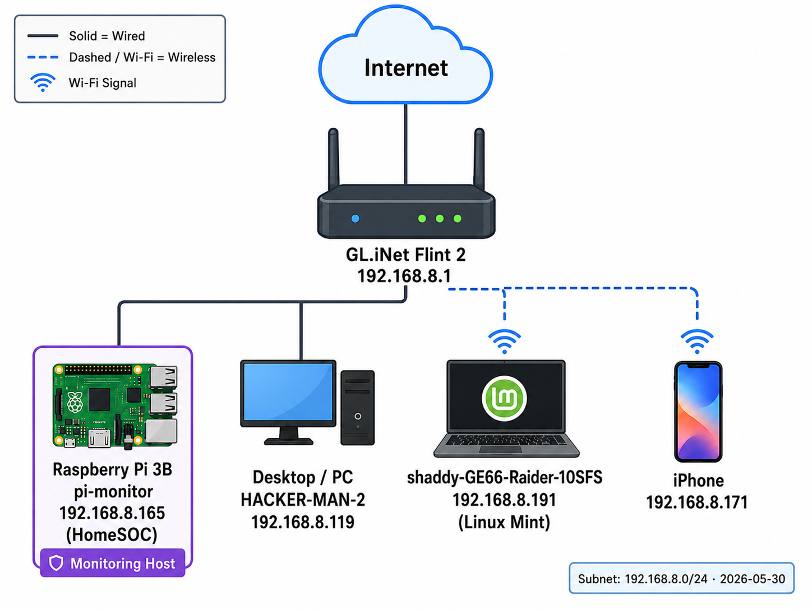

# HomeSOC

HomeSOC is a Raspberry Pi home network monitoring lab I built for my own home network. I made it to practice Linux, networking, automation, Python scripting, and security operations in a more realistic way.

Instead of just running tools manually, I wanted a project that keeps track of devices on my LAN, notices when something new shows up, collects router logs, and gives me a simple workflow for reviewing alerts.

This is a learning and portfolio project. It is not meant to be an enterprise SOC product, and it only runs on my own network.

## What's working

- **Network discovery** — `arp-scan` runs every 15 minutes using a systemd timer. It finds devices on the LAN and records their IP, MAC address, and vendor.
- **Asset inventory** — devices are stored in SQLite and tracked by MAC address so they can still be recognized even if their IP changes.
- **New device review** — new or unapproved devices are flagged as UNREVIEWED. Last-seen filters separate recent devices from historical records. Devices unseen for at least 30 days can be archived with a reason and restored later; a new sighting returns them to active review without approving them.
- **Self-registration** — the Pi identifies itself so it does not keep alerting on its own MAC address.
- **Router log collection** — my Flint 2 router forwards syslog to the Pi over UDP. `rsyslog` writes the logs to a per-host log file, and `logrotate` handles retention.
- **DHCP detection rule** — a watcher checks the router DHCP logs every 5 minutes. If a device that is not approved in the inventory gets an IP address, it writes an alert ticket in Markdown.
- **Alert deduplication** — an existing open source ticket prevents repeat tickets for the same device or SSH source IP.
- **Daily summary tool** — a command-line report pulls from SQLite, the systemd journal, and router logs to show scan activity, current devices, stale devices, router activity, recent alerts, and Pi health.
- **Flask dashboard** — a private web interface accessed through an SSH tunnel for searching and filtering devices, viewing host details and recent logs, reviewing alerts, reading linked runbooks, and editing inventory metadata or approving identified devices from their host pages.
- **Service health** — a read-only dashboard page shows systemd timer status, recent service starts/completions, results, and warnings for the discovery, DHCP, SSH, Splunk sender, and backup jobs.
- **Dashboard login** — a single-user login protects all dashboard pages and actions. Credentials are stored as a private password hash, sessions expire after eight hours, and password resets invalidate previous sessions. The dashboard binds to loopback; SSH carries browser traffic between my PC and the Pi.
- **Incident tracking** — alerts can become incidents with an owner, priority, status, investigation notes, resolution, and a history of changes. Incidents are created only when I save the form.
- **Source alert closure** — after saving an incident as resolved, I can explicitly resolve its linked Markdown alert from the dashboard. The saved resolution is appended while the original evidence is preserved. Archiving a device does not close its alerts.
- **Readable evidence** — alert evidence and linked runbooks render as formatted Markdown, with the raw source available for comparison.
- **Verified backups** — a daily systemd timer backs up the inventory and incident databases, alert evidence, and selected project code/configuration. Each archive is checked through a temporary restore before it is kept. I have also copied verified archives to my Windows PC.
- **SSH detection rule** — a watcher reads the Pi's authentication log every 5 minutes and creates a ticket when one source IP makes at least 5 invalid-user attempts within 10 minutes. Recent attempts are retained between runs.
- **Splunk integration** — an Ubuntu Server VM in VirtualBox runs Splunk Enterprise. The Pi forwards authentication logs through HTTPS HTTP Event Collector (HEC), with certificate verification and a checkpoint for retries.
- **Splunk detection search** — a scheduled search detects repeated invalid SSH usernames and records triggered alerts. I validated it with controlled SSH attempts from my own PC.
- **Restricted VM access** — the VM firewall allows HEC from the Pi and SSH/Splunk web access from my management PC.
- **Runbooks** — RB-001 covers unknown devices and RB-003 covers SSH brute-force investigation. I have used the workflow for real device detections and controlled SSH tests.
- **Vulnerability review** — I wrote a baseline review of my home network with findings, severity, and remediation. One finding was SSH password authentication on the Pi, which I fixed by switching to SSH key-based login.

## Planned

- Detection of failed authentication against existing user accounts
- Additional rules, such as possible port scans
- Additional runbooks for confirmed monitoring use cases
- Notifications outside the dashboard
- Forwarding router logs and inventory events to Splunk
- HTTPS access through a private reverse proxy
- Automated off-Pi backup copies and a full recovery exercise

## How it works

The Raspberry Pi sits on my home network and runs five scheduled jobs:

1. **Discovery scan every 15 minutes**
   This actively scans the LAN with `arp-scan`, saves the results in SQLite, and flags new devices for review. Discovery warnings do not themselves create Markdown alert tickets.

2. **DHCPACK watcher every 5 minutes**
   This reads the router logs forwarded to the Pi. When an unapproved device gets an IP address through DHCP, HomeSOC creates an alert ticket.

3. **SSH watcher every 5 minutes**
   This reads new authentication log entries and correlates invalid-user attempts over a 10-minute window, including attempts split across runs.

4. **Splunk authentication-log sender approximately every 2 minutes**
   This sends new authentication records to the Splunk VM over verified HTTPS. It keeps its checkpoint when sending fails and retries on later runs while the required logs remain available.

5. **Verified backup daily around 03:15**
   This snapshots both SQLite databases, copies alert evidence and selected project files, and checks an extracted temporary copy. It retains the latest seven successful archives outside the repository. Windows copies are currently manual.

The Flask dashboard presents inventory, recent logs, alert evidence, and linked runbooks. I can create an incident from an alert, document my investigation, save a resolution, and then explicitly close the source alert. Saving an incident alone does not close its source ticket.

Stale-device archiving keeps historical records available while removing them from the default inventory view. It does not approve a device, delete evidence, or suppress detection alerts.

When a new device is detected, I follow RB-001. I check the router admin page, look up the MAC vendor, compare scans with router logs, decide whether the device is mine, and update the inventory and documentation. For SSH detections, I use RB-003 to review the source and activity before deciding whether action is needed.

Splunk provides a separate place to search authentication events and run a scheduled detection. Its triggered alerts do not automatically create HomeSOC incidents.

See [Splunk integration and validation](docs/splunk-integration.md), [source alert closure](docs/source-alert-closure.md), [device review](docs/device-review.md), and [backups and restore verification](docs/backups-and-restore.md) for the workflows and their limits.

## Current limitations

- The dashboard has one local account, without roles or multi-user permissions. Access uses an SSH tunnel; the former direct LAN URL is no longer the dashboard entry point. Login throttling is process-local and resets when the dashboard restarts.
- Incident resolution and source alert closure are separate explicit actions. An archived or offline device is not automatically considered investigated or safe.
- Backups are compressed, not encrypted, and exclude credentials, private keys, processing checkpoints, and raw system logs. They are not full Pi or Splunk VM backups. Temporary restore verification is working; a full rebuild has not yet been tested. Windows backup copies are manual.
- The SSH rule detects invalid usernames; it does not yet cover failed authentication for existing accounts.
- Splunk displayed a warning that the scheduled search will not run after the Enterprise trial expires. The Pi's local detectors run independently of Splunk.
- The sender has no separate event spool. If the VM is off long enough for unread logs to be deleted, those events cannot be recovered. The local SSH watcher also does not recover unread entries from rotated logs.
- Splunk HEC uses HTTPS; the Splunk web interface currently uses HTTP with access restricted by the VM firewall.

## Example output

Historical daily summary example (not current live output):

```text
=== HomeSOC Daily Summary ===
Generated:        2026-06-01 17:20 UTC
"Online" = seen in last:    30 min

--- Scan Activity ---
  Scans in last 24h: 97
  Most recent scan:  2026-06-01 17:14 UTC
  Average duration:  3188 ms

--- Asset Inventory ---
  Total assets:        14
  Unreviewed:          0
  Seen in last 30 min: 7

--- Router Log Highlights ---
  DHCPACKs in current log:           32
  New Wi-Fi stations in current log: 27

--- Monitor Host Health ---
  Pi uptime: up 3 days, 20 hours
  Throttle state: throttled=0x0
=== End of Daily Summary ===
```

Example alert ticket when an unapproved device gets a DHCP lease. The MAC and IP are masked for privacy:

```text
---
status: open
severity: low
detected_at: 2026-06-01T12:00:00-04:00
detected_by: dhcpack_watcher
asset_ip: 192.168.8.xxx
asset_mac: xx:xx:xx:xx:xx:xx
runbook: docs/runbooks/RB-001-unknown-device.md
---

# Unknown device joined the network

A device joined the LAN and received an IP through DHCP. Its MAC address is not marked as approved in the asset inventory. Follow RB-001 to investigate.
```

The scheduled jobs run as systemd timers (names shown below):

```text
$ systemctl list-timers | grep homesoc
homesoc-dhcpack.timer    homesoc-dhcpack.service
homesoc-discovery.timer  homesoc-discovery.service
homesoc-sshbrute.timer   homesoc-sshbrute.service
homesoc-auth-splunk.timer homesoc-auth-splunk.service
homesoc-backup.timer     homesoc-backup.service
```

## Hardware

- Raspberry Pi 3 Model B v1.2 (`pi-monitor`)
- GL.iNet Flint 2 router
- Windows PC hosting the Splunk VirtualBox VM
- Home LAN: 192.168.8.0/24

## Software

- Raspberry Pi OS
- Ubuntu Server (Splunk VM)
- VirtualBox
- Splunk Enterprise and HTTPS HEC
- Flask
- UFW (VM firewall)
- Python 3
- SQLite
- arp-scan
- nmap
- rsyslog
- logrotate
- systemd timers
- Git

## Project structure

| Path | Purpose |
| ---- | ------- |
| `scanners/discovery.py` | Network discovery scanner |
| `alerts/dhcpack_watcher.py` | DHCP-based detection rule |
| `alerts/ssh_bruteforce_watcher.py` | Invalid-user SSH detection |
| `alerts/tests/` | SSH detection regression tests |
| `siem/forward_auth.py` | HTTPS authentication-log sender |
| `siem/tests/` | Sender regression tests |
| `scripts/daily-summary.py` | Daily status report |
| `scripts/backup_homesoc.py` | Private backups and temporary restore verification |
| `scripts/tests/` | Backup regression tests |
| `db/schema.sql` | SQLite database schema |
| `collectors/` | rsyslog and logrotate configs |
| `systemd/` | Service and timer files |
| `docs/asset-register.md` | Device inventory |
| `docs/network-diagram.png` | Network diagram |
| `docs/runbooks/` | Investigation and response procedures |
| `docs/vulnerability-reviews/` | Security review writeups |
| `evidence/` | Alert tickets and project evidence |
| `dashboard/` | Flask dashboard, templates, incident handling, and tests |
| `docs/splunk-integration.md` | Splunk setup, searches, validation, and limitations |
| `docs/source-alert-closure.md` | Explicit incident/source alert closure workflow |
| `docs/device-review.md` | Stale filters and reversible device archiving |
| `docs/backups-and-restore.md` | Backup scope, retention, verification, and recovery |
| `docs/service-health.md` | Job health status rules and diagnostic commands |
| `docs/inventory-edit.md` | Explicit inventory edits and device approval |
| `docs/dashboard-login.md` | Login setup, SSH tunnel access, password reset, and limits |

## Network



## Scope

This project only runs on my own home network. I am not scanning or monitoring networks that I do not own or control.

## Why I built it

I wanted a project that was more useful than just saying I ran Nmap or followed a tutorial. HomeSOC gives me a way to practice Linux administration, networking, monitoring, scripting, detection logic, documentation, and basic security operations on a real network that I actually use.

The main goal is to build the project piece by piece and show a realistic security workflow: discover devices, track them over time, detect changes, investigate alerts, document what happened, and improve the setup as I go.

